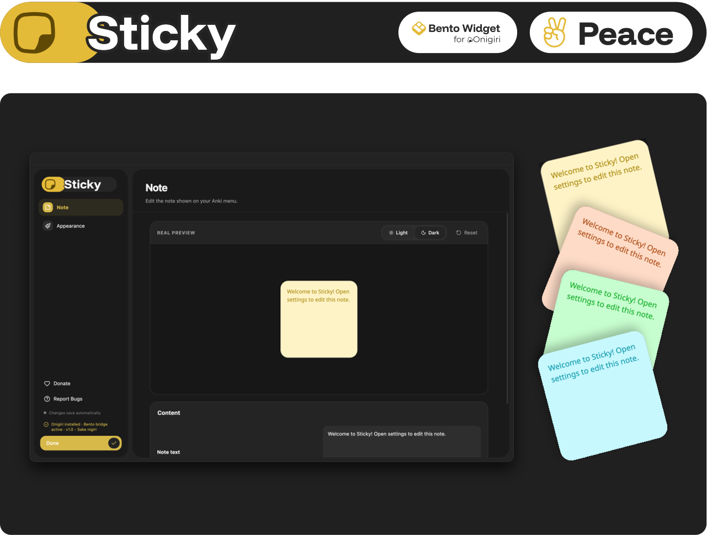

  

<h1 align="center">
	Sticky
</h1>

<h4 align="center">
  A minimal Anki add-on/widget that allows you write messages on main menu. 
</h4>

### License

This project is licensed under the `GNU Affero General Public License v3.0 (AGPL-3.0)`. In short: you’re free to use, study, and modify this code—but if you run it as a service or distribute modified versions, you must make your source available under the same license.

I’ve put a lot of time into designing and maintaining this work. Please respect the license and my effort:
- Don’t copy parts of this project into closed-source or commercial products.
- If you build on it, credit the original and keep your changes open.
- If you find value here, consider contributing back or supporting the project.

